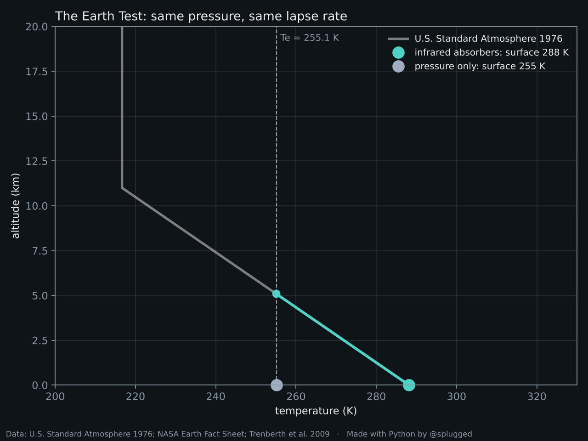

# The Earth Test

**Is Earth's 15 °C set by the pressure and the lapse rate, or by the greenhouse effect? Same planet, same sunlight, same air, same lapse rate: two runs, and an energy ledger that has to balance.**

**Interactive page:** https://davey811.github.io/earth-greenhouse/



## In 60 seconds

| | |
|---|---|
| Infrared emitted by the surface, measured | 396 W/m² |
| Infrared that leaves Earth, the same as the sunlight it absorbs | 240 W/m² |
| Never reaches space: trapped by the air. That is the greenhouse effect | **156 W/m²** |
| The surface with the same air but no infrared absorbers | 255 K (278 K even reflecting nothing) |

## The argument, step by step

1. **Earth is in energy balance.** It absorbs about 240 W/m² of sunlight, averaged over the planet, and sends about the same back to space as infrared. The small difference, under 1 W/m², is the warming now under way.
2. **Without infrared absorbers, the surface can't be warmer than 255 K.** Air that doesn't absorb infrared doesn't emit it either: the surface is the only thing that radiates, and all of its radiation escapes. So σT⁴, averaged over the surface, equals the 240 W/m² absorbed: 255 K, −18 °C, whatever the pressure, the winds, the convection or the lapse rate. A surface with hot and cold patches averages lower, not higher. Even reflecting nothing, the limit would be 278 K.
3. **The real surface emits 396 W/m², and only 240 leave.** The other 156 W/m² of the surface's infrared is absorbed by the air. That is the greenhouse effect: *"the infrared radiation energy trapped by atmospheric gases and clouds"* (Raval & Ramanathan 1989).
4. **The surface lives on what the air sends back.** The surface absorbs about 161 W/m² of sunlight and emits 396. The air sends back down 333 W/m² of infrared, measured; the rest leaves the surface as rising warm air and evaporation (Trenberth et al. 2009; Wild et al. 2013).
5. **The lapse rate fills in the shape.** Earth radiates to space from about 5.1 km, where the air is at 255 K; below it the troposphere warms by 6.5 K per km: 255.02 + 6.5 × 5.097 = 288.15 K. The absorbers set the height, the lapse rate sets the slope. This step explains the profile; the height and slope are read from the measured profile, so 288 K comes out by construction. The proof is in steps 1 to 4.

## Who does what

In the GISS ModelE attribution (Schmidt et al. 2010; Lacis et al. 2010), water vapour does about 50% of the present-day greenhouse effect, clouds about 25%, CO₂ about 20% and the other non-condensing gases about 5%. Water vapour and clouds condense and rain out, so their amount follows the temperature. In the model, removing the non-condensing gases makes the water follow them out: within 50 years the global mean falls to −21 °C, 34.8 K colder, and sea ice grows from 4.6% to 46.7% of the globe.

## Isn't CO₂ saturated?

At the centre of its 15 µm band the air is already opaque. But Earth radiates the band to space from aloft, and more CO₂ lifts that level to colder air: less leaves, until the column below warms up. The forcing grows with the logarithm of the concentration, 5.35 × ln(C / 280) W/m² (Myhre et al. 1998): every doubling adds the same.

| CO₂ | Forcing since 1750 | Emission level higher by | Surface warmer, before feedbacks | With feedbacks, 3 K per doubling |
|---|---|---|---|---|
| 420 ppm, today | 2.17 W/m² | 89 m | 0.58 K | 1.8 K |
| 560 ppm | 3.71 W/m² | 151 m | 0.98 K | 3.0 K |
| 1,120 ppm | 7.42 W/m² | 303 m | 1.97 K | 6.0 K |
| 2,240 ppm | 11.13 W/m² | 454 m | 2.95 K | 9.0 K |

Today's 2.17 W/m² matches the IPCC AR6 assessed CO₂ forcing for 1750–2019, 2.16 W/m². The IPCC assesses 3.93 ± 0.47 W/m² per doubling including fast adjustments, and an equilibrium climate sensitivity of 3 K, likely 2.5–4 K. Before feedbacks, the column warms by forcing / (4σT_e³) = forcing / 3.77, and the emission level rises by that warming divided by 6.5 K/km. A saturated band would give a flat line.

The spectrum on the page shades the CO₂ band, about 13–17 µm, which holds 19% of what a 288 K surface emits, next to its peak, and the window, 8–13 µm, which holds 31%.

## The 5 km coincidence

| | Earth | Venus |
|---|---|---|
| Emission level | 5.10 km | 71.38 km |
| Middle of the mass | 5.48 km | 10.40 km |
| Middle-of-the-mass rule, T_e + Γ z_half | 290.72 K, off by −2.6 K | 300.94 K, off by **+434.4 K** |
| Emission-level rule, T_em + Γ z_e | 288.15 K, as measured | 735.3 K, as measured |

On Earth the two heights are 0.4 km apart, so a rule based on either almost works. On Venus they are 61 km apart. See [The Venus Test](https://github.com/Davey811/venus-greenhouse).

## If compression paid the bill

Suppose the surface were kept at 288 K by the pressure, with no greenhouse effect. It loses σT⁴ − 161 ≈ 230 W/m² more than the sunlight it absorbs. Compression supplies energy only while the air is being compressed: p₀ × v per square metre. The air would have to sink at 2.3 mm/s, 72 km a year; the whole gravitational energy of the atmosphere, 742 MJ/m² (centre of mass at 7.3 km), would last 37 days.

## The Moon test

| | Moon | Earth |
|---|---|---|
| Sunlight arriving | 1,361 W/m² | 1,361 W/m² |
| Bond albedo | 0.11 | 0.294 |
| Sunlight absorbed, planet average | 303 W/m² (26% more) | 240 W/m² |
| Black-body temperature | 270.4 K | 254.0 K (NASA, older albedo; 255.1 K with 0.294) |
| Average surface temperature | below 270 K | 288 K |
| Day–night range | 95–390 K at the equator | 283–293 K |

Same Sun, same distance: the Moon absorbs more and is colder. For a body radiating what it absorbs, the mean of T is at most the fourth root of the mean of T⁴, so its average can't exceed its black-body temperature.

## Dividing by 4 is not a flat Earth

The Sun lights Earth's disc, πR², and Earth radiates from its whole sphere, 4πR². Dividing by 4 averages the absorbed sunlight over the sphere; it doesn't say the temperature is even. A planet with no infrared absorbers, where a share s of the sunlight is spread evenly and the rest is radiated where it falls, with no heat stored:

| Spread evenly | Average temperature | Warmest | Coldest | Sent to space |
|---|---|---|---|---|
| 0% | 144.3 K | 360.8 K | 0 K | 240.2 W/m² |
| 30% | 236.2 K | 338.5 K | 188.8 K | 240.2 W/m² |
| 50% | 246.2 K | 320.8 K | 214.5 K | 240.2 W/m² |
| 90% | 254.7 K | 272.4 K | 248.5 K | 240.2 W/m² |
| 100% | 255.1 K | 255.1 K | 255.1 K | 240.2 W/m² |

The planet always sends 240 W/m² to space; the more uneven it is, the colder its average. The even planet is the warmest case: 255 K is a ceiling, not a trick.

## The Mars test

| | Mars | Earth | Venus |
|---|---|---|---|
| Sunlight absorbed, planet average | 110 W/m² | 240 W/m² | 150 W/m² |
| Black-body temperature | 210 K | 255 K | 227 K |
| Greenhouse effect | about 5 K | 33 K | about 510 K |
| Surface pressure | 0.006 bar | 1 bar | 92 bar |
| CO₂ share of the air | 95% | 0.04% | 96.5% |
| CO₂ above each m² | about 160 kg | 6.6 kg | about 1,000 t |
| Water vapour | 210 ppm | about 1%, variable | 20 ppm |

Mars has 25 times more CO₂ above each square metre than Earth and a much smaller greenhouse effect. Absorption lines widen with pressure: at 6 millibar they are narrow and the infrared slips out between them. Mars also has almost no water vapour, and it absorbs less than half of Earth's sunlight. The share of CO₂ in the air says little; the amount, the pressure and the water decide. Mars's plain average surface temperature, about 202 K, is below its effective temperature, about 208 K, because its surface is so uneven: the fair comparison uses the fourth root of the average of T⁴ (Haberle 2013).

## Using the page

Hover or touch the measured curve to read altitude, temperature and pressure; click or tap to pin the reading. "Copy link to this view" copies a link that reopens the page exactly as it is. Every section and objection has its own address, for example `#moon`, `#mars`, `#saturated`, `#divide-by-4` or `#o-co2-trace`. "Report an error" opens a GitHub issue already filled in.

## Files

```
index.html          interactive page (self-contained)
og.png              preview image shown when the page is shared
earth_test.py       computes every number above from the data file and draws the figure
data/
  earth_us1976.csv  U.S. Standard Atmosphere 1976, 0–50 km
results/
  numbers.txt, earth_test.png
```

```
pip install numpy matplotlib
python3 earth_test.py
```

## Method and caveats

- **Sunlight absorbed:** 1361 × (1 − 0.294) / 4 = 240.2 W/m² (NASA Earth Fact Sheet), T_e = 255.1 K. NASA's own black-body value, 254.0 K, uses the older albedo 0.306.
- **Emission level:** a sphere of radius R + h radiating the same power at T_em = T_e (R / (R + h))^½, R = 6371 km: 255.02 K at 5.097 km on the U.S. Standard Atmosphere.
- **Surface emission:** σT⁴ at 288.15 K is 391 W/m²; the measured 396 is higher because the surface is not uniform and T⁴ averages above (mean T)⁴.
- **Ledger:** "must come back from the air" is what the surface emits minus the sunlight it absorbs. The measured back radiation is larger because the surface also loses heat by rising warm air and evaporation.
- This is a test of energy bookkeeping, not a climate model. The full calculation, with spectra, water vapour and clouds, is the published models cited below.

## Sources

- NASA NSSDC Earth Fact Sheet: https://nssdc.gsfc.nasa.gov/planetary/factsheet/earthfact.html
- NASA NSSDC Moon Fact Sheet: https://nssdc.gsfc.nasa.gov/planetary/factsheet/moonfact.html
- U.S. Standard Atmosphere 1976 (layer temperatures and lapse rates; pressures computed from the hydrostatic equation).
- K. E. Trenberth, J. T. Fasullo and J. Kiehl (2009), *Earth's global energy budget*, Bull. Amer. Meteor. Soc. 90, 311–323, doi:[10.1175/2008BAMS2634.1](https://doi.org/10.1175/2008BAMS2634.1). Surface emission 396, back radiation 333, surface absorbed solar 161 W/m², as cited by Wild et al. (2013).
- M. Wild, D. Folini, C. Schär, N. Loeb, E. Dutton and G. König-Langlo (2013), *The global energy balance from a surface perspective*, Clim. Dyn. 40, 3107–3134.
- K. E. Trenberth and J. T. Fasullo (2012), *Tracking Earth's energy: from El Niño to global warming*, Surv. Geophys. 33, 413–426, doi:[10.1007/s10712-011-9150-2](https://doi.org/10.1007/s10712-011-9150-2).
- G. A. Schmidt, R. Ruedy, R. L. Miller and A. A. Lacis (2010), *The attribution of the present-day total greenhouse effect*, J. Geophys. Res. 115, D20106, doi:[10.1029/2010JD014287](https://doi.org/10.1029/2010JD014287).
- A. A. Lacis, G. A. Schmidt, D. Rind and R. A. Ruedy (2010), *Atmospheric CO₂: principal control knob governing Earth's temperature*, Science 330, 356–359, doi:[10.1126/science.1190653](https://doi.org/10.1126/science.1190653).
- A. Raval and V. Ramanathan (1989), *Observational determination of the greenhouse effect*, Nature 342, doi:[10.1038/342758a0](https://doi.org/10.1038/342758a0).
- G. Myhre, E. J. Highwood, K. P. Shine and F. Stordal (1998), *New estimates of radiative forcing due to well mixed greenhouse gases*, Geophys. Res. Lett. 25, doi:[10.1029/98GL01908](https://doi.org/10.1029/98GL01908).
- IPCC AR6 WG1, [Chapter 7](https://www.ipcc.ch/report/ar6/wg1/chapter/chapter-7/) (2021), *The Earth's energy budget, climate feedbacks and climate sensitivity*: CO₂ forcing 1750–2019 2.16 W/m², 3.93 ± 0.47 W/m² per doubling, equilibrium climate sensitivity 3 K, likely 2.5–4 K.
- NASA NSSDC Mars Fact Sheet: https://nssdc.gsfc.nasa.gov/planetary/factsheet/marsfact.html and Venus Fact Sheet: https://nssdc.gsfc.nasa.gov/planetary/factsheet/venusfact.html
- R. M. Haberle (2013), [*Estimating the power of Mars' greenhouse effect*](https://www.sciencedirect.com/science/article/pii/S0019103513000055), Icarus.
- R. M. Haberle (2015), *Planetary atmospheres: Mars*, Encyclopedia of Atmospheric Sciences, 2nd ed., Academic Press.
- D. C. Catling and J. F. Kasting (2017), *Atmospheric Evolution on Inhabited and Lifeless Worlds*, Cambridge University Press.

Code under the MIT licence. Made with Python by [@splugged](https://x.com/splugged).
